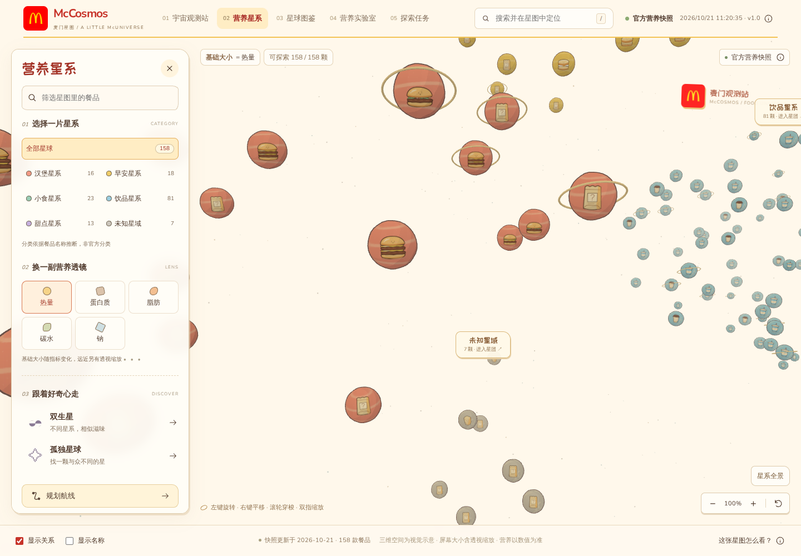

# McCosmos · 麦门星图


基于麦当劳 MCP 的**餐品营养对比与替代发现 Skill**。用自然语言比较真实餐品、按热量条件找候选、解释营养相似性，并通过三维星图查看结果。

面向使用 Agent 查询与比较麦当劳餐品的用户，以及复用可解释营养分析能力的开发者。核心分析无需打开网页；已有三维宇宙、图鉴和实验室是可视化探索入口。独立参赛作品，信息以官方渠道为准。

## 安装 Skill，开始一次餐品比较

下载 [独立 Skill 包 mccosmos-skill.zip](https://github.com/ayingQAQ/McCosmos/releases/download/skill-v1.0.0/mccosmos-skill.zip)，将其中的 `mccosmos` 文件夹放到目标客户端支持的 Skill 目录。也可从成功的 [Skill Actions](https://github.com/ayingQAQ/McCosmos/actions/workflows/skill.yml) 下载同名产物。

- Codex 用户可安装到 `~/.agents/skills/mccosmos`；客户端发现方式以其支持为准，必要时启动新会话。
- 需要 Node.js 24+。独立包已包含依赖和营养快照，不必克隆整个仓库、运行 pnpm 或启动网页。
- 普通快照分析不需要 Token。查询最新数据需要宿主连接麦当劳 MCP；返回来源与获取时间，不用旧快照冒充实时结果。

安装后向 Agent 输入：

> 使用 $mccosmos 对比巨无霸和麦香鱼的营养差异。

| 可以这样问 | Skill 会做什么 |
| --- | --- |
| 对比巨无霸和麦香鱼 | 核对原始规格，列出营养原值与差异 |
| 找比巨无霸热量低、营养特征相近的同类替代 | 严格筛选真实候选，解释相似维度和热量差 |
| 早餐里不超过400 kcal的有哪些，按热量升序 | 按真实数值筛选、排序；缺失不算0 |
| 冰牛奶有哪些杯型 | 列出具体规格，避免混用大小杯数据 |
| 想在星图里看这些餐品 | 提供对应图鉴或星图链接 |

Skill 会检查实际 CLI 结果再答复。相似度不是健康评分；未核实单位保持“原始值”，不声称每份或每100克；没有符合结果时明确说明。[Skill 入口](skills/mccosmos/SKILL.md) · [命令参考](skills/mccosmos/references/commands.md) · [Actions 运行记录](https://github.com/ayingQAQ/McCosmos/actions/workflows/skill.yml)

独立包也能直接运行：

```sh
node "/path/to/mccosmos/scripts/mccosmos.mjs" compare --from="巨无霸" --to="麦香鱼"
node "/path/to/mccosmos/scripts/mccosmos.mjs" alternatives --name="巨无霸" --lower-kcal --limit=3
```

## 可视化探索网站


| 探索站 | 简介 | 可以做什么 |
| --- | --- | --- |
| [宇宙观测站](https://mccosmos.pages.dev/) | 探索首页 | 查看星图概况、随机发现餐品、开启今日任务 |
| [营养星系](https://mccosmos.pages.dev/galaxy) | 三维美食宇宙 | 旋转与穿梭星团，搜索餐品，切换营养透镜，规划星际航线 |
| [星球图鉴](https://mccosmos.pages.dev/atlas) | 餐品资料册 | 按类别筛选、排序、收藏，查看商品图片和营养档案 |
| [营养实验室](https://mccosmos.pages.dev/lab) | 餐品对照台 | 对比 2–3 款餐品，查看原值、差值与相近度，导出对照卡 |
| [探索任务](https://mccosmos.pages.dev/quests) | 每日发现手帐 | 完成双生星、营养排名和指定航线任务，领取星章 |

建议从观测站开始探索；五个站点均可通过顶部导航直接进入。


## 开发与接入

| 入口 | 内容 |
| --- | --- |
| [Actions 与静态包](https://github.com/ayingQAQ/McCosmos/actions/workflows/ci.yml) | 查看构建与运行检查结果，下载可离线运行的静态包 |
| [MCP 接入说明](MCP_INTEGRATION.md) | 数据同步、接口使用与凭据配置方式 |
| [McCosmos Skill](skills/mccosmos/SKILL.md) | 安装后使用自然语言对比、筛选与查找替代餐品 |

## 更多预览




## 食物星球与真实商品照片

宇宙使用奶油纸色、麦当劳红与暖金色。卡通餐品图案附在 **受光照的真实三维球体表面**，保留弧面、明暗交界与立体星环；图案映射到贴合球面的三维网格，参与光照、透视、遮挡和雾化，拾取对应三维球体；旋转、平移、相机飞行继续工作。营养指标只改变尺寸，不重排位置。图鉴与档案则显示有来源的真实商品图片，两类视觉资产各司其职。

当前 158 条营养餐品规格中，**138 条可显示图片**（101 条准确对应/已核对别名，37 条同款尺寸参考）。其中 112 条来自 MCP `query-meals` / `query-meal-detail`，另外 26 条来自麦当劳中国官网营养计算器、同名商品页及套餐推广页。`list-nutrition-foods` 不含图片；积分商城图片不用于餐品映射。

图鉴中同款饮品不再按大小杯重复铺卡：**117 张卡片，其中饮品 40 张**；默认展示中杯，详情中可切换杯型，各自的原始 ID、营养值、收藏与实验室记录保持独立。冰/热、口味与奶基底不同的商品仍分开。

图片保留菜单原名、编码、来源页、原始 URL 与审核说明。尺寸参考在卡片和详情公开标注，官网套餐推广图只用于对应的同名组合；历史推广文案及价格不代表当前供应。尚未确认的 20 条规格与加载失败时显示明确占位，不用其他商品冒充。逐项来源与匹配方式见 [图片映射清单](src/data/food-images.json)。

- [图片映射清单](src/data/food-images.json)：独立于营养数据，不推断配料或营养值。
- [商品照片缓存](public/food-photos)：本地静态文件，支持离线包；`node scripts/cache-food-photos.mjs` 可重新缓存已审核 URL，不需要 Token。
- [原创 SVG 组件](src/components/food-illustrations)：33 个通用示例，不声称还原商品配方。构建时生成本地 SVG，浏览器不调用图像生成服务。

首页任务采用独立的标题、说明与按钮区域，在桌面、平板、手机分别调整列数，避免长中文被操作按钮挤成竖排。

## 功能

- 在真正的 WebGL 三维星系中，左键旋转、右键/方向键平移、滚轮跟随鼠标靠近（双指可缩放）；搜索、分类筛选和热量/蛋白质/脂肪/碳水/钠五种营养透镜保持联动。
- 小星球有鼠标/触控点击余量与可读悬停名称；空白点击保留餐品详情，Escape、关闭或返回漫游退出。分类定位直接进入星团，全景恢复全部分类，缩放、返回与重置放在同一工具栏。
- 营养详情、前三名邻居及数字解释、最少关系跳数航线。
- 跨类别双生星、孤独星球、中文 PNG 星球卡。
- 独立图鉴支持中文搜索、类别/收藏筛选、完整数据筛选、数值排序及分页；收藏与最近查看跨页同步。
- 营养实验室支持 2–3 项对照、替换/移除/交换、独立营养量尺、原值与差值、相似度解释、PNG 对照卡和返回星系规划航线。
- 每日三类真实数据任务：双生星、营养排名、指定航线；验证后领取一次星章，可导出成果卡。任务按本地日期与数据版本固定。
- 33 个原创 SVG 食物通用示例，支持多尺寸、表情、宇宙装饰与独立导出；[插画工坊](https://mccosmos.pages.dev/illustrations.html) 保持独立。
- 分析 CLI 和网页不调用模型 API，不依赖数据库或用户登录；Skill 由宿主 Agent 调用同一套确定性算法，网页无需 Token。

收藏、实验台、最近查看和任务进度保存在版本化 localStorage；官方与演示模式分别存储。清除浏览器数据后消失，存储被禁用时仍能在当前会话探索。分享图包含来源和单位边界，不把未核实的原始值改写为每份 g/mg。

## 安装与启动

需要 Node.js 24+、pnpm 11.21.0。

```sh
pnpm install --frozen-lockfile
pnpm dev
```

打开终端显示的本地地址，默认读取官方快照。

### 下载后离线体验

从成功的 [Actions 运行](https://github.com/ayingQAQ/McCosmos/actions/workflows/ci.yml)下载 `mccosmos-static`，解压后运行：

```sh
node serve.mjs
```

打开 `http://127.0.0.1:4173`。包内含营养快照、已匹配商品照片、卡通 SVG 贴图与字体，无需安装依赖、联网或提供 Token。不支持直接双击 index.html，不使用 Service Worker。

### 数据与演示模式

首次项目同步为 **2026-10-21 11:20（北京时间）**：官方接口160条，完全去重后158条。准确时间和数量见界面/快照 meta，非实时在售菜单。

接口未显式声明部分单位和计量基准，因此显示 kcal 及其他指标原始值，不擅自声称每份、每100克或 g/mg。类别本地推断，相近度为工程算法，非官方评价。

通过 `?demo=1` 或来源说明窗口主动进入演示模式，持续标为“合成示例数据 · 非官方营养信息”。官方数据失败只显示错误，不自动伪装回退。合成数据生成器与真实快照隔离。

### 更新快照

在[麦当劳开放平台](https://open.mcd.cn/mcp)登录并激活 Token。设置环境变量 `MCD_MCP_TOKEN`，或把 `.env.example` 复制为 `.env.local` 填入 Token，然后：

```sh
pnpm sync:mcd
```

Token 不带 Bearer 前缀，不进入浏览器或公开仓库。同步失败保留旧快照，仅调用只读营养工具。

## CLI 与 Skill

```sh
pnpm cosmos:cli -- compare --from="巨无霸" --to="麦香鱼"
pnpm cosmos:cli -- search --category=breakfast --max-kcal=400 --sort=kcal-asc --limit=10
pnpm cosmos:cli -- alternatives --name="巨无霸" --lower-kcal
pnpm cosmos:cli -- list --category=burger
pnpm cosmos:cli -- neighbors --name="巨无霸" --limit=3
pnpm cosmos:cli -- route --from="巨无霸" --to="双层吉士汉堡"
pnpm cosmos:cli -- discover --kind=twins
pnpm cosmos:cli -- discover --kind=lonely --demo
```

返回 JSON：ok/mode/source/fetchedAt/warnings 和 data/error。失败退出码非零；重名返回候选，请使用 `--id`、`--from-id` 或 `--to-id`。图不连通时可能无路径。

上面是源码模式，需要项目依赖。分发时使用 `pnpm skill:build` 生成 `dist-skill/mccosmos`，`pnpm skill:verify` 在仓库外的临时目录验收纯 Node 包；这些构建和验收在 Actions 中执行。复制源码 `skills/mccosmos` 仅得到指令与参考，仍需要项目；用户安装应优先下载完整独立包。不会自动修改客户端配置。

## 验证与分发

每次 push、PR、手动触发由 Actions 执行类型检查、lint、网页构建、Skill 打包、仓库外独立运行检查及参赛文件校验，不需要个人 Token。独立运行检查覆盖比较、替代发现、筛选、杯型、无结果和失败退出码。另在 `scripts/verify-core.ts` 和 `scripts/verify-web.mjs` 保留必要检查：每日任务结果与 BFS 定义一致、单位边界、杯型/收藏/实验室、三维搜索定位、短屏面板和页面下载失败恢复；截图与检查记录保存在 `verification-evidence` 产物中。历史开发文档已移除。

历史完整回归和独立 Agent 实际调用仍可查阅 [全量运行记录](https://github.com/ayingQAQ/McCosmos/actions/runs/40034749294) 与 [Agent 演练记录](https://github.com/ayingQAQ/McCosmos/actions/runs/40034359098)。Agent 演练不等同于所有客户端的自动发现验证。

Cloudflare Pages：构建命令 `pnpm build`，输出 `dist`，Node24，无需服务端凭据。Actions 在检查通过后使用同一次构建的产物发布。自动发布需要仓库 Secrets `CLOUDFLARE_API_TOKEN`（目标账户 Pages Edit 权限）与 `CLOUDFLARE_ACCOUNT_ID`；未配置时明确标记发布待完成，不声称网页已更新。`release.json` 和页脚提供发布版本。也可手动上传已验证的 Actions 产物。在线体验见 [McCosmos](https://mccosmos.pages.dev/)。

## 技术与原创性

页面按需加载，三维布局与发现分析进入星系后计算；每日航线任务通过连通分量判断可达性，避免逐对重复寻路。星系详细诊断默认关闭，仅开发环境或显式 `?diagnostics=1` 启用。星系使用按需渲染、InstancedMesh 批量绘制与有上限的插画解码缓存（32 张 / 8 MiB）；静止后停止动画帧，退出页面释放 GPU 资源。保留真正的三维透视与逐星球拾取。

React、TypeScript、Vite、Three.js WebGL2（PerspectiveCamera、OrbitControls、Raycaster）、自绘 SVG、少量 Rough.js 纸面装饰；Canvas2D 仅用于材质纹理与卡片导出。Zod 和 TOON 严格适配、MCP SDK 同步；构建和独立 Skill 运行由 GitHub Actions 检查。

三维渲染代码见 [src/galaxy](src/galaxy)。

星球、纸张布局和插画为原创。感谢 [Wired Elements](https://github.com/rough-stuff/wired-elements)、[PaperCSS](https://github.com/papercss/papercss)、[Rough.js](https://github.com/rough-stuff/rough) 的线条启发，不套用完整布局。第三方许可见 [THIRD_PARTY_NOTICES.md](THIRD_PARTY_NOTICES.md)。代码 MIT，官方数据、声明和第三方素材各遵守自身条款。

参赛要求文件保留 [官方原文声明](CONTEST_DECLARATION.md)、[MCP 接入说明](MCP_INTEGRATION.md) 与 [脱敏配置](mcp-config.example.json)。
